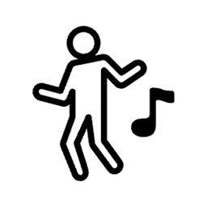
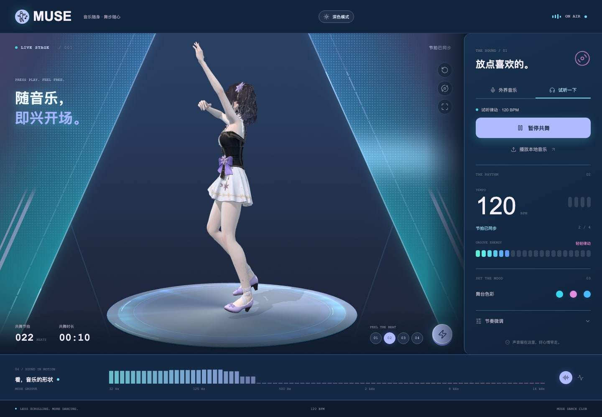
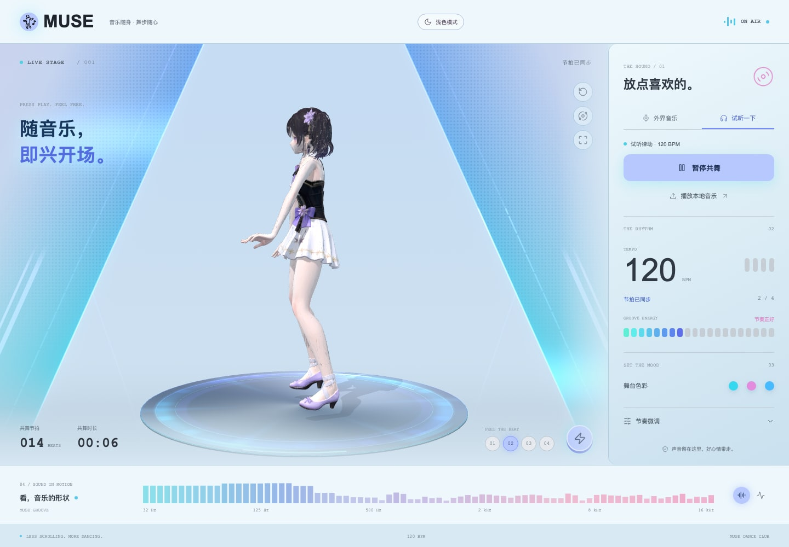
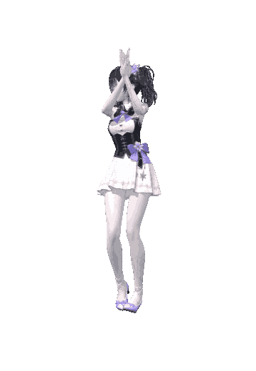

  

<h1 align="center">MUSE</h1>

<strong>一个会跟着音乐跳舞的桌面少女。</strong>

音乐驱动的 3D 少女舞台 · 透明桌面舞伴 · 本地运行

<a href="https://github.com/AmberSkills/muse/releases/download/v1.0.0/MUSE_1.0.0_aarch64.dmg">下载 macOS 版</a> · <a href="https://github.com/AmberSkills/muse/releases/tag/v1.0.0">版本说明</a>

---

## 在桌面上看她跳舞

打开 MUSE，选一首电脑里的歌，少女就会跟着节拍跳舞。歌曲放完，她还会鞠个躬。

想边做事边听歌，就点一下缩小。舞台和面板会收起来，只留她在桌面上跳。
挡住东西了，拖到旁边就行。

不用注册账号，也不用配置 API Key，装好就能用。

## 舞台和迷你模式

<table>
  <tr>
    <td width="68%" align="center"></td>
    <td width="32%" align="center"></td>
  </tr>
  <tr>
    <td align="center">浅色舞台</td>
    <td align="center">迷你模式 · 透明背景</td>
  </tr>
</table>

| | 舞台模式 | 迷你模式 |
| --- | --- | --- |
| 画面 | 完整 3D 舞台、音乐灯光、播放控制 | 只有跳舞的少女，背景透明 |
| 氛围 | 浅色 / 深色外观，三组舞台配色 | 没有舞台、面板和按钮 |
| 适合 | 看完整的舞蹈和灯光效果 | 边做事边听歌 |
| 切换 | 点击全屏按钮下方的「缩小」图标 | 双击少女或按 Esc 回到舞台 |

迷你窗口会保持置顶，可以拖着少女换个位置。切换模式时，音乐和舞蹈接着走。
右键少女也能恢复；macOS 菜单 **Stage → Restore** 提供同样的操作，快捷键为 **⌘⇧M**。

## 她会些什么？

- 根据音乐的节奏和强弱选择动作，尽量在乐句结束时切换。
- 内置 23 个动作片段，除了舞蹈，还有空闲、过渡和结束致敬的动作。
- 舞台有浅色、深色两种外观，以及电光青、糖果紫光、晴空蓝三组配色。
- 缩小后只显示少女，背景透明，音乐继续播放。
- 自动识别 BPM，也可以手动调速度、点击打拍，或微调节奏偏移。
- 暂停音乐时，舞蹈也会停住。

## 怎么放歌

| 方式 | 怎么用 |
| --- | --- |
| 本地音乐 | 点击「播放本地音乐」，选择电脑里的音频文件 |
| 麦克风 | 授权后聆听周围的音乐；这不是系统音频内录 |
| 试听律动 | 用内置的 120 BPM 节奏先试一下 |

音频格式是否能播放取决于系统支持的解码能力。迷你模式不会自动播放音乐，可以先在舞台里选歌再缩小。

## 下载和安装

下载 **[MUSE_1.0.0_aarch64.dmg](https://github.com/AmberSkills/muse/releases/download/v1.0.0/MUSE_1.0.0_aarch64.dmg)**，或前往 [Releases 页面](https://github.com/AmberSkills/muse/releases) 查看版本说明和校验文件。

1. 打开 DMG，把 **MUSE** 拖入 **Applications / 应用程序**。
2. 启动 MUSE，等待少女加载完成。
3. 选一首本地音乐，或者点击「试听律动」。
4. 想进入桌面陪伴模式，点击舞台右侧的缩小图标。

| 当前安装包 | 状态 |
| --- | --- |
| Apple Silicon Mac（M 系列芯片） | 已构建和验证，DMG 约 15 MB |
| macOS 版本 | 配置最低为 macOS 12.0；未逐个系统版本验证 |
| Intel Mac / Windows / Linux | 暂无经过验证的安装包 |

当前 macOS 包使用临时签名，尚未经过 Apple 公证，首次打开可能受到系统安全检查限制。
Release 中附有 `SHA256SUMS.txt`，可用于核对下载完整性。

## 几个你可能会问的问题

**我的音乐会被上传吗？**  
不会。音频分析、节奏计算和动画播放都在本机进行，不接入云端识别服务。
安装包已经包含模型和动作，正常使用不需要启动开发服务器，也不需要联网。

**她怎么偶尔慢半拍，或者快了一倍？**  
自动节奏识别可能把拍速判断成一半或两倍。人声、弱节拍、噪声和变速歌曲也会影响判断。
可以用手动 BPM、点击打拍，以及 -500 到 +500 ms 的节奏偏移调整；正值会让舞蹈延后。

**缩小之后，怎么找回控制面板？**  
双击少女、右键少女，或聚焦后按 Esc。macOS 还可以从菜单 **Stage → Restore** 恢复。

**这是 AI 实时生成舞蹈吗？**  
不是。MUSE 会从现有动画中选择动作并匹配节拍，使用过渡让动作自然衔接。

## 开发与发布

MUSE 使用 **Tauri 2 + Rust** 构建桌面应用，**Three.js** 渲染角色与舞台，**Vite** 负责前端构建。

- [开发说明](docs/DEVELOPMENT.md)：运行、打包、动作资源和节奏逻辑。
- [发布指南](docs/PUBLISHING.md)：将介绍文档与安装包上传到 GitHub。
- [版本说明](docs/RELEASE_NOTES.md)：当前版本的功能与已知限制。

开发说明面向完整源码工程。如果仓库仅发布介绍和安装包，请直接下载 Release；源码构建还需要原始 GLB 动作资源。

